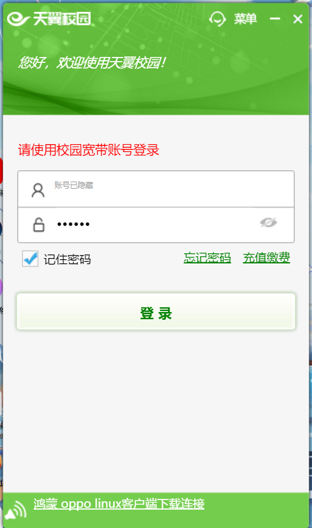

# 天翼校园自动登录守护

开机发现没网？它替你把天翼校园客户端拉起来，再点一下「登录」。

## 它解决什么问题

天翼校园客户端有两个毛病：

- **不会开机自启**（部分版本有自启项，但不一定生效，也不一定在登录前就把网拨通）
- **掉线后不会自己重拨**，必须手动打开客户端点一次「登录」

于是每次开机都是这套流程：发现没网 → 找客户端 → 点登录 → 才能上网。

这个脚本常驻后台，就干三件事：

1. **开机自动拉起**客户端（Windows 登录后立即执行）
2. 客户端停在登录页时，**自动点一次「登录」**
3. 掉线（进程消失 / 探测不通）时，**自动重启客户端并重新登录**

> 它**不存账号密码、不模拟登录协议、不绕过任何认证**。做的只是启动官方客户端、点一下界面上的按钮，
> 用的仍然是你客户端里已经保存好的凭据。



登录页长这样（账号已打码）。脚本要点的就是那一行「登 录」——它不是一个可识别的控件：
这个界面是内嵌网页（窗口类 `wkeWebWindow`），没有控件树，UIA 定位不到，只能按客户区比例
`(0.500, 0.595)` 去点。窗口尺寸变了会按比例换算，不用改代码。

## 3 分钟上手

```powershell
# 1) 下载（git clone，或页面上的 Code → Download ZIP，解压到任意目录）

# 2) 管理员身份打开 PowerShell，进到脚本所在目录，执行安装
cd "D:\你的目录\天翼校园自动登录"
powershell -ExecutionPolicy Bypass -File .\TianyiAutoLogin.ps1 -Install

# 3) 验证（只读，不动任何东西）
powershell -ExecutionPolicy Bypass -File .\TianyiAutoLogin.ps1 -DryRun
```

`-Install` 会弹一次 UAC，装完立刻在后台启动，不用等下次开机。之后每次登录 Windows 都会自动运行。

`-DryRun` 正常输出长这样：

```
脚本位置    : C:\ProgramData\TianyiAutoLogin（已部署，受 ACL 保护）
部署目录    : C:\ProgramData\TianyiAutoLogin  存在
部署副本    : 与源码一致
计划任务    : TianyiAutoLogin  已注册
客户端路径  : D:\...\Chinatelecom_GDPortal\ESurfingClient.exe  存在
路径来源    : 自动探测
哈希校验    : 通过
客户端      : PID=1234 已运行 300 秒
网络连通    : 在线
掉线判定    : 连续 4 次探测失败（约 60 秒）
客户端自启  : 发现 2 项（有效 1 项）…
```

## 它怎么判断、怎么动作

| 环节 | 做法 |
|---|---|
| 在线判据 | ping `223.5.5.5`，失败时退化为 TCP `223.5.5.5:53`。**不读**客户端配置里的 `connState`（实测是残留值，进程都没了它仍然是 1） |
| 巡检间隔 | 15 秒一次；连续 4 次失败（约 60 秒）才判定掉线，避免瞬时抖动误杀 |
| 进程消失 | 立即拉起，两次拉起至少间隔 60 秒 |
| 掉线 | 重启客户端，但有两道闸：客户端已稳定运行 ≥120 秒、距上次重启 ≥300 秒（连续失败 3 次后放宽到 900 秒） |
| 自动登录 | 拉起后 8 秒仍没网就点一次「登录」，最多 5 次，间隔 10 秒；已联网则完全不点 |
| 单实例 | 互斥量 `TianyiAutoLoginWatchdog`，重复启动直接退出 |
| 登录成功后 | **不关窗口、不结束进程**，让它挂托盘由客户端自己保活（实测杀掉进程必断网） |
| 日志 | 只在状态变化时写一行，平时完全静默；超过 1MB 自动滚动 |

点击前会确认**该坐标上最顶层的窗口确实是客户端**（`WindowFromPoint`），锁屏时直接跳过。
这里不用“客户端是不是前台窗口”当判据——后台进程抢前台常被系统拒绝，会导致一次都点不出去。

## 客户端装在哪儿都行

脚本按这个顺序找客户端，**多数情况不需要配置**：

1. 脚本同目录的 `client-path.txt`（存在就用它）
2. **注册表自动探测**：卸载项里的 `DisplayIcon` / `InstallLocation`、`Run` 项里的 `AutoStart.exe`
3. 常见默认位置 `C:\Program Files (x86)\Chinatelecom\GDPortal`

装在 D 盘、E 盘、自定义目录都能自己认出来。只有“注册表里也没有任何记录”时才需要手动指定：
在脚本同目录新建 `client-path.txt`，写一行安装目录。

```
D:\Program Files\Chinatelecom\GDPortal
```

> 记事本另存时把“保存类型”选成**所有文件**，否则会存成 `client-path.txt.txt`，脚本读不到。
> `-DryRun` 里的「路径来源」会告诉你是走配置、自动探测，还是自动探测回退。

## 部署后是什么样

全部在 `C:\ProgramData\TianyiAutoLogin\`：

| 文件 | 说明 |
|---|---|
| `TianyiAutoLogin.ps1` | 脚本副本，计划任务实际执行它 |
| `天翼校园自动登录.vbs` | 隐藏启动器（`-Install` 生成） |
| `client-path.txt` | 最终使用的客户端路径 |
| `client-sha256.txt` | 客户端 exe 的 SHA256 基准 |
| `autologin.log` | 运行日志（普通用户可读，不可写） |
| `watchdog.pid` | 守护进程 PID，卸载时用来精确停进程 |

计划任务名 `TianyiAutoLogin`，触发方式「登录时」+「以最高权限运行」。

两个说明：

- **为什么是「登录时」不是「开机时」**：客户端需要桌面会话才弹得出界面、才点得到登录按钮，
  所以触发点放在用户登录之后。开机后进到桌面即可，脚本会自己接手。
- **为什么要部署到 `%ProgramData%`**：计划任务是提权运行的，脚本若留在用户可写目录，
  任何以你身份运行的程序都能改写它，下次登录就能静默拿到管理员权限。安装时会把目录所有者
  收归 Administrators、只留 SYSTEM/Administrators 可写，并回读校验；锁不住就直接中止。

## 日常维护

**改完脚本要重新部署。** `-Install` 是单向复制，改了源码不会自动同步，跑的仍是 `%ProgramData%` 里那份旧代码。
`-DryRun` 的「部署副本」一行就是用来暴露这件事的：

| 显示 | 含义 |
|---|---|
| `与源码一致` | 跑的就是当前源码 |
| `不一致：改了源码但没重新 -Install` | 需要重新安装 |
| `读不到（用管理员运行 -DryRun 才能比对）` | 非管理员读不了受保护目录，属正常 |

**客户端升级后要重新信任。** 官方更新 `ESurfingClient.exe` 后哈希会变，守护会拒绝启动并在日志里写明原因
（这是设计，不是故障）。确认是官方升级后执行：

```powershell
powershell -ExecutionPolicy Bypass -File .\TianyiAutoLogin.ps1 -TrustClient
```

**卸载**（删任务 + 停守护 + 清目录）：

```powershell
powershell -ExecutionPolicy Bypass -File .\TianyiAutoLogin.ps1 -Uninstall
```

## 遇到问题先看日志

日志在 `C:\ProgramData\TianyiAutoLogin\autologin.log`（普通权限就能读），或者直接看 `-DryRun` 末尾。

| 现象 | 原因 | 处理 |
|---|---|---|
| 日志反复写「客户端不存在」 | 路径不对 | `-DryRun` 看「客户端路径」，手动建 `client-path.txt` |
| 「客户端校验失败」/「已停止自动拉起」 | 客户端升级了，哈希对不上 | `-TrustClient` |
| 装完没反应，脚本文件不见了 | 被安全软件隔离 | 把 `C:\ProgramData\TianyiAutoLogin` 加白名单 |
| 点开了登录页却没登录 | 坐标偏了（改版 / 缩放 / 高 DPI） | 重新标定 `$LoginPointX` / `$LoginPointY` |
| 出现两个客户端窗口 | 客户端自带自启和计划任务同时拉起 | 在客户端设置里关掉开机自启 |
| `-Install` 提示权限没锁住 | `takeown` / `icacls` 没成功 | 按提示手动改目录所有者后重试，别绕过 |

## 安全与隐私

- **会触发安全软件告警**：`-ExecutionPolicy Bypass` + 隐藏窗口 + 计划任务提权自启，
  是杀软的典型启发式特征。Defender 或校园终端防护可能提示甚至隔离，需要自行加白。
- **不采集、不上传任何数据**。脚本只有三个外部动作：ping `223.5.5.5`、启动客户端、模拟一次鼠标点击。
- **日志不含账号信息**，只有时间、进程号、点击坐标；但它能反映作息（几点在线/掉线），贴到公开场合前建议脱敏。
- **自动点击是固定相对坐标**。若客户端在同一窗口里弹出公告/广告/协议层，坐标校验仍会通过，
  点击可能落在弹层上。介意的话把 `$LoginPointX` / `$LoginPointY` 调到一片安全空白区，或干脆注释掉点击逻辑。
- 脚本以管理员权限运行、会修改计划任务与系统进程，使用风险自负。

## 已知限制

- 只适配 Windows 10 / 11 + Windows PowerShell 5.1
- 依赖客户端窗口类名 `wkeWebWindow`（内嵌网页，没有控件树，UIA 定位不到按钮，只能按坐标点）
- 客户端大版本更新后坐标、窗口尺寸可能失效
- 连续 5 次点击登录仍不成功就放弃，等人工处理
- 只保证「拉起 + 点一次登录」，不处理短信验证码、二次认证等交互

## 免责声明

本项目仅供**个人在自己账号上**做掉线保活使用。

- 不得用于共享账号、代他人登录、绕过计费或规避任何认证机制
- 是否允许在校园网使用此类自动化工具，取决于你所在学校/运营商的使用协议，请自行确认
- 脚本以管理员权限修改计划任务与系统进程，使用风险自负

## License

[MIT](LICENSE)
